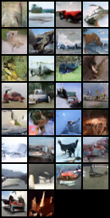

# diffusionPack

## Abstract

diffusionPack is a PyTorch package for developing and studying diffusion-based generative models. It starts with Denoising Diffusion Probabilistic Models (DDPM) and aims to provide reusable implementations for unconditional and conditional generation, reducing the need to rebuild baselines for each research project. Planned extensions include DDIM, score-based generative models, classifier-free guidance, flow matching, and related methods.

## Implementation Principles

Implementations are developed with reference to original research papers and publicly available author code. The focus is on understanding the underlying mathematics, keeping the implementation readable, and checking numerical behavior before using models in research. The package is intended to support reproduction, comparison, and extension of generative modeling methods.

## DDPM tasks and model sizes

The package has three tasks: unconditional generation, conditional restoration, and conditional prediction.
Each task supports `model="light"` and `model="original"`. Light changes U-Net capacity; it uses the same DDPM noise schedule, epsilon objective, and sampler.

| Entry | Condition | Generated target | Model |
| --- | --- | --- | --- |
| Unconditional | No condition | RGB or grayscale image | `DDPMUNet` |
| Restoration | Degraded image | Clean image | `RestoreUNet` |
| Prediction | Historical spatial maps | One future spatial map | `PredictionUNet` |
| Light preset | Applies to any task above | Same target as the selected task | Base channels 64, one encoder ResBlock per resolution |

See the [implementation and Research PStack audit](docs/model-audit.md) for equations, supported data, test evidence, and remaining validation work.

## DDPM Light: 30 actual generated images

These are outputs from our unconditional CIFAR-10 Light run: 6,079,811 parameters, batch size 4, 20 cumulative epochs, and 250,000 training steps.
Sampling used EMA weights, 1,000 DDPM steps, seed 42, and batch size 2.
The run executed on an NVIDIA L40S. RTX 3060 Ti execution and FID were not measured.

<a href="docs/light-results.md"></a>

[View all 30 individual outputs and provenance](docs/light-results.md). Images are native 32×32 RGB, displayed larger here.
The gallery comes from the earlier local training export, not a training run of commit `28d9a93`. It is not evidence of restoration or forecasting quality.

## Installation

```bash
pip install git+https://github.com/Pogjunan/diffusionPack.git
```

## Update

```bash
pip install --upgrade --force-reinstall git+https://github.com/Pogjunan/diffusionPack.git
```

## Forecasting with SSI maps

Download [run_prediction.py](run_prediction.py) and set the grid size, channel multipliers and physical value range. Each row in `train.csv` or `test.csv` contains `timestamp,path,available_at` for one NumPy grid. Both times include a UTC offset. Split the series by time before training.

`history_lag_minutes` is the interval from the last input map to forecast issue. `lead_minutes` runs from issue to target. With both set to 30, an issue at 12:00 uses maps through 11:30 and predicts 12:30. Each input must be available by 12:00.

Run `python run_prediction.py` with `mode = "train"` or `mode = "inference"`. Set `samples` to draw several forecasts per issue. Each inference run saves its grids and `predictions.csv` in a separate folder.
