# DDPM Light: actual CIFAR-10 outputs

These 30 images are the complete saved sample set from our 20 epoch unconditional Light checkpoint. No images were selected or replaced for this gallery.

| Setting | Value |
| --- | --- |
| Task | Unconditional image generation |
| Model | DDPM Light, 6,079,811 parameters |
| Training data | CIFAR-10 training split, 50,000 images |
| Native output | 32×32 RGB |
| Training budget | 20 cumulative epochs, 250,000 steps, batch 4 |
| Optimizer | Adam, learning rate 0.0002, warmup 5,000 |
| EMA | 0.9999 |
| Sampling | EMA weights, 1,000 DDPM steps, seed 42, batch 2 |
| Hardware | NVIDIA L40S; RTX 3060 Ti was not tested |

## All 30 samples

Click an image to open the unchanged native PNG. Display dimensions do not change the saved pixels.

<table>
<tr>
<td align="center"><a href="assets/light-cifar10-epoch20/sample_001.png">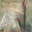</a> 001</td>
<td align="center"><a href="assets/light-cifar10-epoch20/sample_002.png">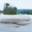</a> 002</td>
<td align="center"><a href="assets/light-cifar10-epoch20/sample_003.png">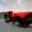</a> 003</td>
<td align="center"><a href="assets/light-cifar10-epoch20/sample_004.png">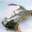</a> 004</td>
<td align="center"><a href="assets/light-cifar10-epoch20/sample_005.png">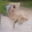</a> 005</td>
<td align="center"><a href="assets/light-cifar10-epoch20/sample_006.png">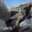</a> 006</td>
</tr>
<tr>
<td align="center"><a href="assets/light-cifar10-epoch20/sample_007.png">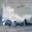</a> 007</td>
<td align="center"><a href="assets/light-cifar10-epoch20/sample_008.png">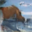</a> 008</td>
<td align="center"><a href="assets/light-cifar10-epoch20/sample_009.png">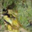</a> 009</td>
<td align="center"><a href="assets/light-cifar10-epoch20/sample_010.png">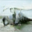</a> 010</td>
<td align="center"><a href="assets/light-cifar10-epoch20/sample_011.png">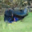</a> 011</td>
<td align="center"><a href="assets/light-cifar10-epoch20/sample_012.png">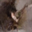</a> 012</td>
</tr>
<tr>
<td align="center"><a href="assets/light-cifar10-epoch20/sample_013.png">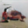</a> 013</td>
<td align="center"><a href="assets/light-cifar10-epoch20/sample_014.png">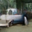</a> 014</td>
<td align="center"><a href="assets/light-cifar10-epoch20/sample_015.png">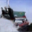</a> 015</td>
<td align="center"><a href="assets/light-cifar10-epoch20/sample_016.png">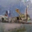</a> 016</td>
<td align="center"><a href="assets/light-cifar10-epoch20/sample_017.png">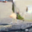</a> 017</td>
<td align="center"><a href="assets/light-cifar10-epoch20/sample_018.png">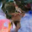</a> 018</td>
</tr>
<tr>
<td align="center"><a href="assets/light-cifar10-epoch20/sample_019.png">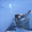</a> 019</td>
<td align="center"><a href="assets/light-cifar10-epoch20/sample_020.png">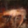</a> 020</td>
<td align="center"><a href="assets/light-cifar10-epoch20/sample_021.png">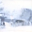</a> 021</td>
<td align="center"><a href="assets/light-cifar10-epoch20/sample_022.png">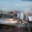</a> 022</td>
<td align="center"><a href="assets/light-cifar10-epoch20/sample_023.png">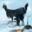</a> 023</td>
<td align="center"><a href="assets/light-cifar10-epoch20/sample_024.png">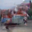</a> 024</td>
</tr>
<tr>
<td align="center"><a href="assets/light-cifar10-epoch20/sample_025.png">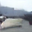</a> 025</td>
<td align="center"><a href="assets/light-cifar10-epoch20/sample_026.png">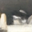</a> 026</td>
<td align="center"><a href="assets/light-cifar10-epoch20/sample_027.png">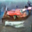</a> 027</td>
<td align="center"><a href="assets/light-cifar10-epoch20/sample_028.png">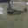</a> 028</td>
<td align="center"><a href="assets/light-cifar10-epoch20/sample_029.png">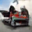</a> 029</td>
<td align="center"><a href="assets/light-cifar10-epoch20/sample_030.png">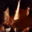</a> 030</td>
</tr>
</table>

## Provenance and limits

The [original grid](assets/light-cifar10-epoch20/grid.png) and individual files are copied byte-for-byte from the local inference outputs. The [provenance record](assets/light-cifar10-epoch20/provenance.json) contains image hashes, the checkpoint hash, retained source hashes, and runtime settings.

The run predates reviewed commit `28d9a93`. The exact original training Git revision was not recorded. It used a local export with epoch snapshot and individual-image export additions. Its checkpoint remains local and is not bundled in this repository. These images are not presented as a new training run of the reviewed commit.

The checkpoint was the user-requested final 20 epoch checkpoint, not a checkpoint selected by a test metric. No FID or other quantitative image-quality score was computed. These are unconditional generation examples, not restoration or SSI forecasting results.

Verify the published files with `python -m scripts.verify_gallery`. See the [implementation audit](model-audit.md) for the separate synthetic conditional checks.
